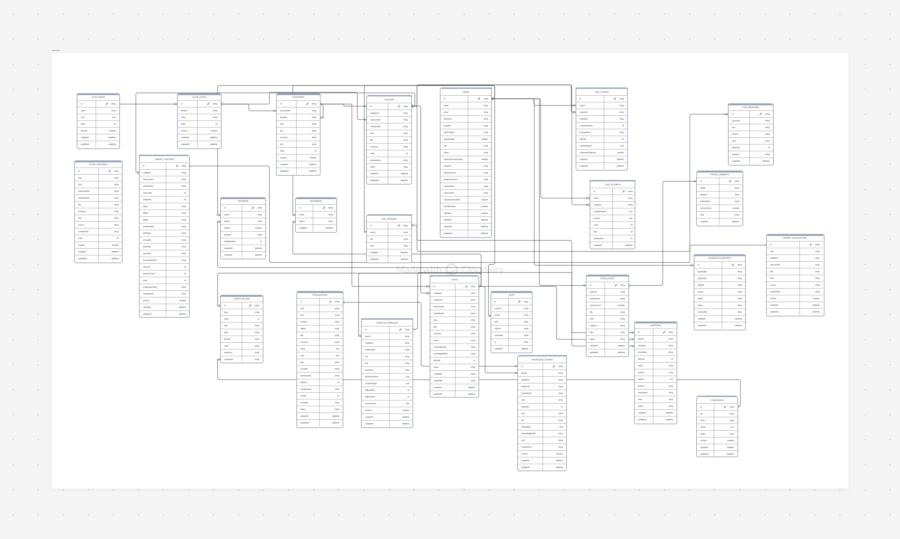

# VisTutorBD Backend: API and Database

Express 5 + TypeScript REST API for **VisTutorBd**, a visualization-first math platform covering Play, Nursery and Class 1–12 in English and Bangla.

The backend owns accounts and roles, the class taxonomy, the content library, visualization specs, deterministic question generation, quiz attempts, learner state, the grounded AI chat, the RAG knowledge base and moderation. The Next.js client lives in `../vistutorbd`.

> **Content-library phase.** The old taxonomy content is archived under `legacy-content/` and removed from MongoDB. Chapter content comes from `content-library/all-class-content-new/` and compliant visualization HTML under `content-library/generated-visualizations/`. Five standalone legacy carousels sync separately from `legacy-content/old-resource/` for the home hero and legacy lessons menu.

## Stack

- Express 5, TypeScript, tsup, tsx, Biome
- Prisma ORM **6.19** + MongoDB (`prisma`/`@prisma/client` pinned: Prisma 7 has no stable MongoDB connector)
- JWT access/refresh tokens in httpOnly cookies
- bcryptjs password hashing
- Google Identity Services (ID token) and OAuth authorization-code callback
- Nodemailer SMTP with a console fallback in development
- Optional Redis with an in-memory fallback
- OpenRouter for chat and embeddings, with a deterministic local embedding stub
- mathjs answer verification and seeded question generators
- node-cron maintenance jobs

## Database ERD



Field-level details are in the [Prisma and MongoDB schema reference](docs/prisma-mongodb-schema-reference.txt).

## Setup

```bash
npm install
cp .env.example .env      # fill in DATABASE_URL and secrets
npx prisma generate
npm run db:push           # MongoDB has no migrations
npm run seed              # bands, levels, templates, demo accounts + library chapters
npm run dev
```

| Script | Purpose |
| --- | --- |
| `npm run dev` | `tsx watch src/server.ts` |
| `npm run build` | Bundle with tsup into `dist/` |
| `npm start` | Run `dist/server.js` |
| `npm run typecheck` | `tsc --noEmit` |
| `npm test` | Unit tests for the math engine and generators |
| `npm run db:generate` | Generate Prisma Client |
| `npm run db:push` | Push the schema to MongoDB |
| `npm run db:studio` | Open Prisma Studio |
| `npm run seed` | Idempotent configuration seed + library chapter sync |
| `npm run library:sync` | Sync `library_chapters` from the class-content manifest |
| `npm run figure:pages` | Render chapter PDF pages to backend-only reference JPEGs |
| `npm run figure:extract` | Extract line-art figure briefs from stored reference page images |
| `npm run figure:link` | Attach page-matched figure ids to figure-dependent questions |
| `npm run figure:validate` | Validate every chapter figure brief |
| `npm run content:validate` | Validate every visualization against `art-rules/RULES.md` |
| `npm run content:archive` | Back up and purge the legacy MongoDB content collections |
| `npm run lint:check` / `lint:fix` | Biome lint |
| `npm run format:check` / `format:fix` | Biome format |

## Environment

All variables live in `.env.example`; `.env` is intentionally left for the operator to fill. The example admin and learner credentials are showcase-only and match the frontend one-click demo buttons. On startup, automatic seeding creates any missing configured accounts even when other users already exist; existing users are left unchanged. If the database is unreachable, restart the backend or run `npm run seed` after connectivity is restored.

| Group | Variables |
| --- | --- |
| Core | `NODE_ENV`, `PORT`, `BACKEND_URL`, `FRONTEND_URL`, `AUTO_SEED` |
| Database | `DATABASE_URL` |
| Auth | `BCRYPT_SALT_ROUNDS`, `JWT_ACCESS_SECRET`, `JWT_REFRESH_SECRET`, `JWT_ACCESS_EXPIRES_IN`, `JWT_REFRESH_EXPIRES_IN` |
| Google | `GOOGLE_CLIENT_ID`, `GOOGLE_CLIENT_SECRET`, `GOOGLE_REDIRECT_URI` |
| Mail | `SMTP_HOST`, `SMTP_PORT`, `SMTP_USER`, `SMTP_PASS`, `MAIL_FROM` |
| Redis | `REDIS_URL` or `REDIS_USER`/`REDIS_PASSWORD`/`REDIS_HOST`/`REDIS_PORT` |
| OpenRouter | `OPENROUTER_API_KEY`, `OPENROUTER_CHAT_MODELS`, `OPENROUTER_FALLBACK_CHAT_MODELS`, `OPENROUTER_VISION_MODEL`, `OPENROUTER_EMBEDDING_MODEL` |
| Free voice | `OPENROUTER_TTS_MODELS`, `OPENROUTER_FALLBACK_TTS_MODELS`, `OPENROUTER_TTS_VOICE`, `OPENROUTER_FREE_ROUTER_FALLBACK` |
| Embeddings | `EMBEDDING_PROVIDER` (`openrouter` \| `local` \| `stub`), `EMBEDDING_MODEL`, `EMBEDDING_DIMENSIONS` |
| Chat | `CHAT_RATE_LIMIT_PER_HOUR` |
| Visitor reports | `VISITOR_REPORT_CRON`, `REPORT_TIMEZONE`, `CONTACT_EMAIL` |
| Seeds | `ADMIN_*`, `MODERATOR_*`, `USER_*`, `LEGACY_JSON_DIR` |

Optional services degrade gracefully:

- **SMTP missing** → OTPs are printed to the backend console.
- **Redis missing** → OTP/session/rate-limit state uses an in-memory store.
- **OpenRouter missing** → chat returns a grounded extract from the knowledge base (`provider: "grounded-fallback"`).
- **Voice** → English answers use the free OpenRouter TTS model; Bangla uses the browser’s `bn-BD` voice. If TTS fails, the client falls back to the browser voice.
- **Google missing** → credential login still works; Google buttons are hidden by the frontend.

## Project structure

```text
prisma/schema.prisma              Users, taxonomy, library chapters/visualizations, knowledge, quiz, chat,
                                  moderation, visits
src/server.ts                     Connect services, optional seed, cron, listen
src/app.ts                        Express app and /api/v1 route mounting
src/app/config/                   Typed env parsing
src/app/lib/                      prisma, redis, mail, google, jwt, cookies, openrouter, embeddings,
                                  mathEngine, questionGenerator, taxonomy, cron
src/app/middleware/               checkAuth (auth/optionalAuth), validateRequest, rateLimit, errors
src/app/module/<feature>/         route → controller → service → validation
src/app/module/library/           Library classes, chapters and visualization reads
src/app/scripts/seed.ts           Configuration seed entry point
src/app/scripts/library-sync.ts   Manifest → library_chapters sync
src/app/scripts/validate-visualizations.ts  Art-rule validation for generated HTML
src/app/scripts/archive-legacy.ts Legacy MongoDB backup + purge
src/app/utils/library-sync.ts     Manifest parsing, validation and autoplay/height injection
src/app/templates/                EJS email templates
content-library/
  all-class-content-new/          Sole source for class/chapter metadata (site-manifest.json)
  art-rules/                      Mandatory RULES.md and Example.html authoring contract
  generated-visualizations/       Sole source for approved per-chapter HTML
legacy-content/                   Archived old app content, old root HTML, old seeds and DB backup
  old-resource/                   Archived standalone lesson carousels (Class 1–5, 6–8, 9–10, Nursery, differentiation)
reference-data/                   Reference material only, never served at runtime
docs/api/                         API reference
docs/prisma-mongodb-schema-reference.txt  Entity, field, constraint and relationship reference
```

## Roles

| Role | Capabilities |
| --- | --- |
| Guest | Read published taxonomy/topics/visualizations, generate quizzes, ask the chat (rate-limited) |
| `USER` | Everything a guest can do, plus bookmarks, progress, saved quiz config, attempts, knowledge search |
| `MODERATOR` | Author taxonomy/topics/visualizations/knowledge, read the moderation queue and quiz templates |
| `ADMIN` | Everything a moderator can do, plus user management, deletes and knowledge reindexing |

## Response envelope

Successful responses:

```json
{
  "success": true,
  "statusCode": 200,
  "message": "Topics fetched.",
  "data": {},
  "meta": {}
}
```

Errors:

```json
{
  "success": false,
  "statusCode": 404,
  "message": "Topic not found.",
  "error": {}
}
```

Auth uses httpOnly `accessToken` and `refreshToken` cookies. Browser requests must send `credentials: "include"`.

## API

Base path: `/api/v1`. Health is also available at `/health`.

| Module | Mount | Docs |
| --- | --- | --- |
| Auth | `/auth` | [docs/api/auth.md](docs/api/auth.md) |
| Users | `/user` | [docs/api/users.md](docs/api/users.md) |
| Learner state | `/user-state` | [docs/api/user-state.md](docs/api/user-state.md) |
| Taxonomy | `/taxonomy` | [docs/api/taxonomy.md](docs/api/taxonomy.md) |
| Library | `/library` | `GET /classes`, `GET /classes/:classId/chapters`, `GET /chapters/:chapterId`, `GET /chapters/:chapterId/visualization` |
| Topics | `/topics` | [docs/api/topics.md](docs/api/topics.md) |
| Visualizations | `/visualizations` | [docs/api/visualizations.md](docs/api/visualizations.md) |
| Quiz | `/quiz` | [docs/api/quiz.md](docs/api/quiz.md) |
| Chat | `/chat` | [docs/api/chat.md](docs/api/chat.md) |
| Knowledge | `/knowledge` | [docs/api/knowledge.md](docs/api/knowledge.md) |
| Moderation | `/moderation` | [docs/api/moderation.md](docs/api/moderation.md) |
| Analytics | `/analytics` | `POST /visit` (public), `GET /visitors` (editor), `POST /visitors/report` (admin) |
| Contact | `/contact` | `POST /` sends the contact form over SMTP |
| Health | `/health` | [docs/api/health.md](docs/api/health.md) |

See [docs/api/README.md](docs/api/README.md) for conventions, enums and role rules.

## Seed data

`npm run seed` is idempotent and creates **configuration only**:

1. 5 class bands: `PLAY_NURSERY`, `C1_5`, `C6_8`, `C9_10`, `C11_12`.
2. 14 class levels: `play`, `nursery`, `class-1` … `class-12`.
3. The default companion personality.
4. Two question templates: `addition.singleDigit` (Play/Nursery) and `addition.twoDigit` (Class 1–5).
5. `ADMIN`, `MODERATOR` and demo `USER` accounts from env.
6. When `forum_posts` is empty, 10 starter forum questions with maths (`$...$`) and starter comments. Existing posts are never overwritten.
7. Library chapters from `content-library/all-class-content-new/Class Content Library/_data/site-manifest.json`. The sync writes `library_chapters` and links any approved `library_visualizations`; it never creates lesson HTML.

The library sync is idempotent and runs from both `npm run seed` and `npm run library:sync`. `AUTO_SEED=true` fills empty collections on startup and never overwrites edited data. Startup seeding runs after the API starts and retries for a few minutes if Atlas is unreachable; whitelist the machine's public IP under **Atlas → Network Access** if it cannot connect.

## Content library pipeline

All new content comes from the two root folders that were adopted in this pass:

| Source | Purpose |
| --- | --- |
| `content-library/all-class-content-new/` | Class/chapter metadata and source Markdown, including `_data/site-manifest.json` |
| `content-library/art-rules/RULES.md` | Mandatory authoring contract for every visualization |
| `content-library/art-rules/Example.html` | Approved Lesson Studio template (`makeLesson`, `A.page`, `A.say`, `CFG`) |
| `content-library/generated-visualizations/` | Only accepted location for per-chapter visualization HTML |

Workflow:

```bash
# 1. Put approved HTML in content-library/generated-visualizations/
# 2. Validate it against RULES.md (fails on missing height bridge, loop, etc.)
npm run content:validate

# 3. Sync chapters + publish the HTML into MongoDB
npm run library:sync

# 4. Typecheck the backend
npm run typecheck
```

### Figures

Scanned diagrams are backend reference material only. The figure scripts run
with Bun. Render pages, extract a structured brief, then validate it:

```bash
npm run figure:pages -- --class class-8 --chapter ch-08-quadrilateral
npm run figure:extract -- --class class-8 --chapter ch-08-quadrilateral
npm run figure:link -- --class class-8 --chapter ch-08-quadrilateral
npm run figure:validate
```

The brief is stored at
`classes/<class>/chapters/figures/<chapter-file>.figures.json`. Chat injects it
as text; lessons must redraw it with line art and must not embed the scans.
`mupdf` is used only by this dev-time renderer and is AGPL-3.0 licensed.

The sync stores the chapter manifest, reports the tallest accepted frame, injects the runtime height bridge, and adds autoplay/loop support (`#bRep` restarts when `#scrub` reaches the end). A chapter with no approved HTML remains visible but returns **404** from `/library/chapters/:chapterId/visualization`; the Learn page shows a "visualization being prepared" panel instead of a broken player.

`npm run content:archive` wrote a dated JSON backup under `legacy-content/mongodb-backup/` and deleted the old categories, chapters, topics, visualizations and learn carousels. `npm run library:sync` now imports the five standalone lesson HTML files from `legacy-content/old-resource/` as class-aware `LearnCarousel` records. See `legacy-content/README.md` for the archive map.

### Visitor report

Every six hours (`VISITOR_REPORT_CRON`, default `0 */6 * * *`) the backend counts unique visitors and page views for the current day in `REPORT_TIMEZONE` (default `Asia/Dhaka`), plus a rolling six-hour count, and emails the admin and all moderator addresses. Trigger it manually with `POST /api/v1/analytics/visitors/report` (admin) or inspect with `GET /api/v1/analytics/visitors` (admin/moderator).

## Notes

- MongoDB has no migration files; use `db:push`.
- Old source files stay under `legacy-content/`. The five standalone visual lesson HTML files there are synced into MongoDB as class-aware `LearnCarousel` records by `npm run library:sync`; they appear on the home hero and in the `/learn` menu. Add new chapter lessons through `content-library/`.
- Reference ids (`chapterId`, `topicId`, `userId`, …) are plain strings with no Prisma relations, matching the existing MongoDB style.
- Google-only accounts have no password and must use Google login.
- The chat model never computes quiz answers: generated answers are verified by `lib/mathEngine.ts`.
- `dist/` and `.env` are build/operator artifacts; commit `.env.example` only.
